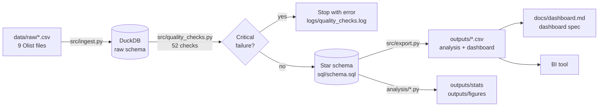
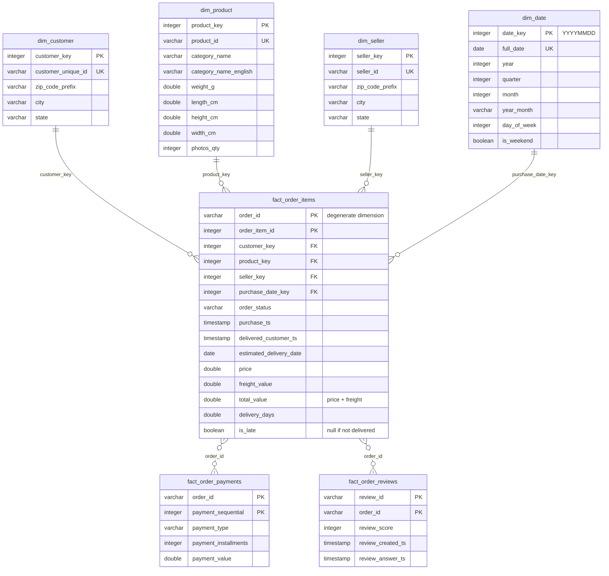
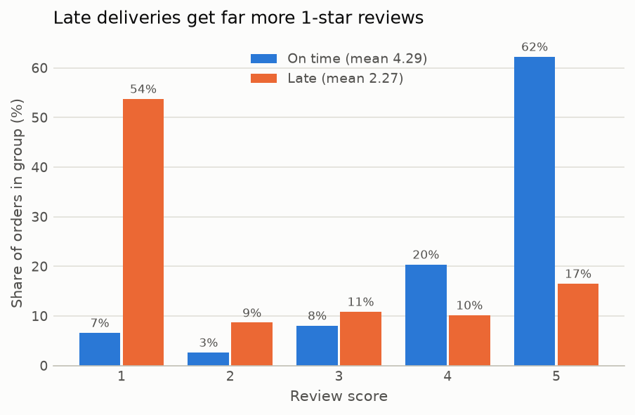
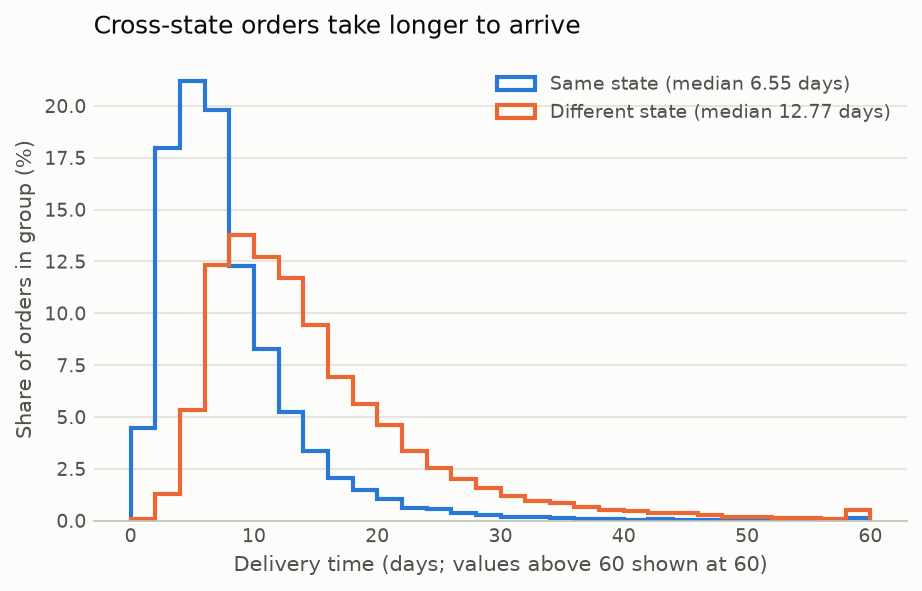

# Olist E-Commerce BI Pipeline

An end-to-end business intelligence project on the
[Olist Brazilian E-Commerce dataset](https://www.kaggle.com/datasets/olistbr/brazilian-ecommerce):
ingestion and data-quality checks, a star schema, SQL analysis, statistical
tests, a dashboard specification, and a one-command pipeline that rebuilds
everything from the raw CSVs.

**Stack:** Python, DuckDB, SQL, pandas, SciPy, statsmodels, matplotlib.

**Headline finding:** late delivery is the clearest driver of customer
dissatisfaction in this data. Orders that arrive late average **2.27** stars
against **4.29** for on-time orders, and **53.77%** of late orders get one star.

## Business questions

1. How are revenue and order volume trending month to month?
2. Which customer states get their orders on time, and which do not?
3. Which product categories have the most and least satisfied customers?
4. How many customers come back to buy again?
5. Which categories bring in the most revenue, and how is each growing?
6. Does late delivery hurt review scores, and by how much?
7. How far do distance and product weight explain delivery time?

## Architecture



`run_pipeline.py` runs every stage in order. Each run deletes the database and
previous outputs first, so rerunning always rebuilds the same result.

## Data model

The warehouse is a star schema built by [sql/schema.sql](sql/schema.sql).
The central fact table, `fact_order_items`, has **one row per order item**
(112,650 rows). Payments and reviews describe a whole order, so they are kept
in their own fact tables and linked by `order_id` rather than joined onto items,
which would double count them.



Two views sit on top of the tables:

- `v_orders` rolls `fact_order_items` up to one row per order, for order counts and on-time rates.
- `v_order_reviews` keeps one review per order, so order-level joins never fan out.

**Definitions used throughout**

| Term | Definition |
|---|---|
| Revenue | Item price plus freight, in Brazilian reais (BRL) |
| Orders and revenue | Exclude canceled and unavailable orders |
| On time | Delivered on or before the estimated delivery date; delivered orders only |
| Customer | `customer_unique_id`; the source `customer_id` is generated per order |

## How to run

Requires Python 3.11 or later.

1. Install the dependencies:

   ```bash
   pip install -r requirements.txt
   ```

2. Download the dataset from
   [Kaggle](https://www.kaggle.com/datasets/olistbr/brazilian-ecommerce) and
   unzip the nine CSV files into `data/raw/`.

3. Run the pipeline:

   ```bash
   python run_pipeline.py
   ```

A full run takes under a minute. It writes the database to `data/olist.duckdb`,
query results to `outputs/`, statistics to `outputs/stats/`, figures to
`outputs/figures/`, the quality log to `logs/quality_checks.log`, and
regenerates `docs/dashboard.md`. Add `--skip-stats` to skip the statistics scripts.

Each stage also runs on its own, for example `python -m src.quality_checks` or
`python analysis/01_ttest_reviews.py`.

## Project structure

```
run_pipeline.py      single entry point
src/                 ingestion, quality checks, schema build, exports, dashboard spec generator
sql/schema.sql       star schema DDL and load
sql/analysis/        the five business-question queries
sql/dashboard/       one query per dashboard tile, chart and map
analysis/            t-test, chi-squared test, regression
docs/dashboard.md    dashboard specification (generated)
outputs/             query results, statistics and figures (generated)
```

## Key findings

Every number below is produced by the pipeline; the source file is named with each finding.

### Data quality

The pipeline runs 52 checks on the raw tables: 40 pass, 12 raise warnings and
none is a critical failure (`logs/quality_checks.log`). The warnings are known
quirks of the dataset and are listed under [Limitations](#limitations).

### Sales

- **15,735,527.03 BRL** in revenue from **98,199** orders (`outputs/kpi_01_total_revenue.csv`, `outputs/kpi_02_total_orders.csv`).
- Monthly orders grew from 787 in January 2017 to 6,421 in August 2018. The peak month was November 2017, with 7,421 orders and 1,172,191.68 BRL (`outputs/01_monthly_revenue_orders.csv`).
- The top three categories by revenue are health_beauty (1,437,665.78 BRL), watches_gifts (1,298,292.47 BRL) and bed_bath_table (1,240,386.13 BRL) (`outputs/05_top_categories_mom_growth.csv`).
- **Only 3.04% of customers bought more than once**: 2,887 of 94,983 (`outputs/04_repeat_purchase_rate.csv`). Growth in this period came from new customers, not returning ones.

### Delivery

- **93.23%** of delivered orders arrived on time: 89,936 of 96,470 (`outputs/kpi_03_on_time_rate.csv`).
- Reliability varies widely by state (`outputs/02_on_time_rate_by_state.csv`). São Paulo (SP), with 40,499 delivered orders, is at 95.51%; Rio de Janeiro (RJ), with 12,351, is at 87.89%; Alagoas (AL) is lowest at 78.59%.
- A high on-time rate does not mean fast delivery. Amazonas (AM) has the highest rate, 97.24%, but an average delivery time of 26.43 days against 8.76 days in SP. Its delivery estimates are simply long.

### Customer satisfaction

- The average review score is **4.09** out of 5 across 98,673 reviewed orders (`outputs/kpi_04_avg_review_score.csv`).
- Among categories with at least 100 reviewed orders, books_general_interest scores highest (4.463) and office_furniture lowest (3.618, with 22.64% of its reviews at 1 or 2 stars) (`outputs/03_review_score_by_category.csv`).

### Does late delivery hurt reviews? (t-test)

Welch two-sample t-test on review scores (`outputs/stats/01_ttest_reviews.txt`):

| Group | Orders | Mean score |
|---|---|---|
| On time | 89,443 | 4.29 |
| Late | 6,381 | 2.27 |

- Difference: **2.02 points** (95% CI 1.981 to 2.059), t = 100.79, p < 1e-300.
- Effect size: **Cohen's d = 1.709**, a large effect.
- In plain language: a late order is rated about two stars lower. 53.77% of late orders get one star, against 6.62% of on-time orders.



### Is delivery status related to rating bucket? (chi-squared)

Chi-squared test of independence (`outputs/stats/02_chi2_delivery_review.txt`):

| | Low (1-2) | Neutral (3) | High (4-5) |
|---|---|---|---|
| On time | 9.27% | 8.07% | 82.66% |
| Late | 62.42% | 10.88% | 26.70% |

- chi-squared = 15,558.1, 2 degrees of freedom, n = 95,824, **p < 1e-300**.
- **Is it meaningful?** Yes. With this many orders almost any difference would be statistically significant, so the p-value alone proves little. The effect size does: **Cramér's V = 0.403**, a medium effect, and the share of low ratings is 62.42% for late orders against 9.27% for on-time ones.

### What explains delivery time? (linear regression)

OLS on 96,448 delivered orders, with robust (HC3) standard errors
(`outputs/stats/03_regression_delivery_time.txt`):

| Term | Coefficient | 95% CI |
|---|---|---|
| Intercept | 7.61 days | 7.54 to 7.68 |
| Seller in a different state from the customer | +7.18 days | 7.08 to 7.28 |
| Order weight, per kg | +0.144 days | 0.128 to 0.159 |

- **R² = 0.1352.** The model explains 13.5% of the variance; a typical prediction is off by about 8.88 days.
- Crossing a state line adds about a week. Weight matters far less: about 1.4 days per 10 kg.
- Limitations of this model:
  - Same state versus different state is a crude distance proxy. Brazilian states differ enormously in size, and neighbouring states are treated the same as opposite ends of the country.
  - Delivery time is right-skewed with extreme outliers, so the residuals are not normal.
  - Seller handling time, carrier, season and remoteness are all omitted, so the coefficients are associations, not causal effects.



### What I would recommend

- Treat on-time delivery as a customer-satisfaction metric, not only a logistics one: it is the strongest signal of a bad review in this data.
- Look first at RJ. It is the second-largest state by volume and runs about 7.6 points below SP on on-time rate.
- Investigate retention. A 3.04% repeat rate means almost every order comes from a newly acquired customer.

## Dashboard

[docs/dashboard.md](docs/dashboard.md) specifies a one-page dashboard with
4 KPI tiles, 3 charts and 1 map, each with its exact SQL and the CSV it reads.
The spec is generated from the files in `sql/dashboard/`, so it cannot drift
from the queries that produce the data. The dashboard itself is not built here.

## Limitations

**Of the data**

- **It is a sample from one marketplace.** Results describe Olist orders from 2016 to 2018 and may not generalise.
- **The edge months are incomplete.** September, October and December 2016 and September 2018 hold between 1 and 290 orders, and November 2016 is absent. Trend and growth figures use January 2017 to August 2018.
- **There is no cost data**, so the project measures revenue, not profit.
- **775 orders have no order items** and so do not appear in the item-grain fact table.
- **610 products have no category** and are grouped as "unknown"; 13 more have a category with no English translation and keep the Portuguese name.
- **Some timestamps are inconsistent.** 8 delivered orders have no delivery date and 23 show delivery to the customer before handoff to the carrier.
- **A few products have unusable weights** (4 at zero, 2 missing); orders containing them are excluded from the regression.
- **Reviews are per order, not per item.** For category scores, an order's review is credited to every category in the order, which blurs multi-category orders.
- **Customer location can change.** A customer who ordered from more than one address is assigned the location of their most recent order.

**Of the analysis**

- **"On time" is relative to Olist's own estimate.** A state with generous estimates scores well without being fast, as the AM example shows.
- **The statistical tests show association, not causation.** Late orders may differ from on-time ones in other ways, such as product type or region, that also affect reviews.
- **Review scores are ordinal.** The t-test treats them as numeric; a Mann-Whitney U test is run as a check and agrees (p < 1e-300).
- **Small states and small categories are noisy.** Several states have under 150 delivered orders, and some categories have fewer than 20 reviewed orders.
- **Payments are not reconciled against item totals.** Revenue comes from item price plus freight; payment records are loaded but not used in any metric.
